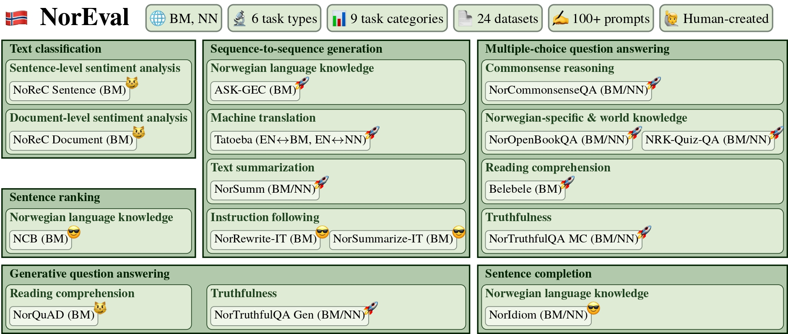

# 🇳🇴 NorEval

### Paper

* Title: `NorEval: A Norwegian Language Understanding and Generation Evaluation Benchmark`
* Paper: [aclanthology.org/2025.findings-acl.181](https://aclanthology.org/2025.findings-acl.181/) (Findings of ACL 2025)
* Homepage: [github.com/ltgoslo/noreval](https://github.com/ltgoslo/noreval)
* Results: [interactive dashboard](https://ltgoslo.github.io/llm-dashboard/noreval/)



**Overview of the NorEval design.**  😼 denotes datasets used in [NorBench](https://aclanthology.org/2023.nodalida-1.61/), [NLEBench](https://aclanthology.org/2024.emnlp-main.317/), [ScandEval](https://aclanthology.org/2023.nodalida-1.20/), and [SEB](https://proceedings.neurips.cc/paper_files/paper/2024/file/4746bb91bd073ec7eef930d5775122ba-Paper-Datasets_and_Benchmarks_Track.pdf); 🚀 represents datasets that have not been used in the existing Norwegian benchmarks; and 😎 denotes our novel datasets introduced as part of NorEval. EN=English; BM=Norwegian Bokmål; NN=Norwegian Nynorsk.

🇳🇴 NorEval is a multi-task Norwegian language understanding and generation evaluation benchmark that combines existing peer-reviewed datasets with datasets created from scratch. NorEval covers diverse task categories: sentiment analysis, Norwegian language knowledge, Norwegian-specific \& world knowledge, machine reading comprehension, commonsense reasoning, machine translation, text summarization, instruction following, and truthfulness. Our main evaluation principles are:

- 🌐 **Linguistic diversity**: support for both of the official written standards of Norwegian: Bokmål and Nynorsk (the minority variant), as well as Northern Sámi.
- 📊 **Task diversity**: coverage of various least addressed tasks for Norwegian.
- 🧠 **Data quality**: focus on only peer-reviewed human-created datasets to ensure reliable evaluation in the context of the Norwegian language, culture, and values.
- 📏 **Prompt sensitivity**: evaluation across multiple human-written prompts to account for the prompt sensitivity.
- 👩🏻‍🔬 **Standardized evaluation**: integration of NorEval into LM Evaluation Harness for flexible and reproducible evaluation.

The task configs here correspond to NorEval version 1.3 in [github.com/ltgoslo/noreval](https://github.com/ltgoslo/noreval).

### Tasks

The task names end with the language code: `nob` (Bokmål), `nno` (Nynorsk), `sme` (Northern Sámi), `eng` (English); a translation task name lists the source language first.

| Dataset | Tasks | Type |
|:---|:---|:---|
| **Linguistic knowledge** | | |
| [NCB](https://huggingface.co/datasets/hcfa/ncb) | `ncb_nob` | Multiple choice |
| [NoCoLA](https://huggingface.co/datasets/ltg/nocola) | `nocola_nob` | Multiple choice |
| [SLIDE](https://huggingface.co/datasets/ltg/slide) | `slide_nob_nno_swe_dan` | Multiple choice |
| [MultiBLiMP](https://huggingface.co/datasets/jumelet/multiblimp) | `multiblimp_noreval_sme` | Multiple choice |
| [NorIdiom](https://huggingface.co/datasets/Sprakbanken/Norwegian_idioms) | `noridiom_nob`, `noridiom_nno` | Generation |
| [ASK-GEC](https://huggingface.co/datasets/ltg/ask-gec) | `ask_gec_nob` | Generation |
| **Language understanding** | | |
| [NoReC Sentence](https://huggingface.co/datasets/ltg/norec_sentence) | `norec_sentence_nob` | Multiple choice |
| [NoReC Document](https://huggingface.co/datasets/ltg/norec_document) | `norec_document_nob` | Multiple choice |
| [NorOpenBookQA](https://huggingface.co/datasets/ltg/noropenbookqa) | `noropenbookqa_nob`, `noropenbookqa_nno` | Multiple choice |
| [NorBelebele](https://huggingface.co/datasets/ltg/norbelebele) | `norbelebele_nob` | Multiple choice |
| [NorQuAD](https://huggingface.co/datasets/ltg/norquad) | `norquad_nob` | Generation |
| **World knowledge & reasoning** | | |
| [NRK-Quiz-QA](https://huggingface.co/datasets/ltg/nrk_quiz_qa) | `nrk_quiz_qa_nob`, `nrk_quiz_qa_nno` | Multiple choice |
| [NorOpenBookQA (without facts)](https://huggingface.co/datasets/ltg/noropenbookqa) | `noropenbookqa_no_fact_nob`, `noropenbookqa_no_fact_nno` | Multiple choice |
| [NorCommonsenseQA](https://huggingface.co/datasets/ltg/norcommonsenseqa) | `norcommonsenseqa_nob`, `norcommonsenseqa_nno` | Multiple choice |
| [NorTruthfulQA](https://huggingface.co/datasets/ltg/nortruthfulqa_mc) | `nortruthfulqa_mc_nob`, `nortruthfulqa_mc_nno` | Multiple choice |
| [NorTruthfulQA](https://huggingface.co/datasets/ltg/nortruthfulqa_gen) | `nortruthfulqa_gen_nob`, `nortruthfulqa_gen_nno` | Generation |
| **Generation & summarization** | | |
| [NorSumm](https://huggingface.co/datasets/SamiaT/NorSumm) | `norsumm_nob`, `norsumm_nno` | Generation |
| [NorRewrite-Instruct](https://huggingface.co/datasets/ltg/norrewrite-instruct) | `norrewrite_instruct_nob` | Generation |
| [NorSummarize-Instruct](https://huggingface.co/datasets/ltg/norsummarize-instruct) | `norsummarize_instruct_nob` | Generation |
| **Translation** | | |
| [NorSumm Translation](https://huggingface.co/datasets/ltg/norsumm-nob-nno-translation) | `translation_nob_nno`, `translation_nno_nob` | Generation |
| [Tatoeba](https://huggingface.co/datasets/Helsinki-NLP/tatoeba_mt) | `translation_eng_nob`, `translation_nob_eng`, `translation_eng_nno`, `translation_nno_eng` | Generation |
| [Sámi Tatoeba](https://huggingface.co/datasets/ltg/saami-tatoeba) | `translation_nob_sme`, `translation_sme_nob` | Generation |

### Groups, Tags, and Tasks

#### Groups

* `multiblimp_noreval_sme`: the Northern Sámi MultiBLiMP subtasks, one per agreement phenomenon (e.g., `multiblimp_noreval_sme_SG-PL`), with a size-weighted overall score.

#### Tags

* `<dataset>_<language>` (the names in the table above): all variants of a task, i.e., all prompts and, for multiple-choice tasks with formulations, all three task formulations.
* `<dataset>_<language>_<formulation>` (e.g., `norbelebele_nob_mcf`): all prompts of one formulation of a multiple-choice task.

#### Tasks

* The 35 tasks in the table run as 302 harness tasks, one per prompt variant: 210 from the 14 multiple-choice datasets with five prompts in three formulations (15 each), 78 from the generation tasks (4–6 prompts each, and one each for NorRewrite-Instruct and NorSummarize-Instruct), 12 MultiBLiMP subtasks, and NCB and NoCoLA.
* Each prompt variant is a task: `<dataset>_<language>_p<N>` for generation tasks (e.g., `norquad_nob_p2`) and `<dataset>_<language>_<formulation>_p<N>` for multiple-choice tasks (e.g., `norbelebele_nob_mcf_p2`). `ncb_nob`, `nocola_nob`, `norrewrite_instruct_nob` and `norsummarize_instruct_nob` have a single variant.
* Multiple-choice tasks, except the minimal-pair tasks (NCB, NoCoLA and MultiBLiMP), share each prompt across three formulations: `cf` (cloze: the options are not shown and the model scores the full option text), `hybrid` (the options are listed without labels and the model scores the full option text), and `mcf` (the options are listed with labels and the model scores the label only).
* Multiple-choice tasks report accuracy and probability of the correct answer, with raw, per-character (`_norm`) and PMI (`_mutual_info`) normalizations. The minimal-pair tasks (NCB, NoCoLA and MultiBLiMP) have no PMI metrics: their prompt is empty, so PMI cannot tell the choices apart.
* Generation tasks are sampled (temperature 1.0, no top-*p*/top-*k* truncation) several times per document, and the scores are averaged over the samples. Standard errors are bootstrapped over documents.
* Every dataset is pinned to a fixed commit with `dataset_kwargs: revision`, so results do not change when a dataset is updated on the Hugging Face Hub.
* The primary metric, random baseline, category and language(s) of every task are stored in its `metadata`.

#### Requirements

* [Helsinki-NLP/tatoeba_mt](https://huggingface.co/datasets/Helsinki-NLP/tatoeba_mt), used by the English ↔ Bokmål/Nynorsk translation tasks, and [ltg/norbelebele](https://huggingface.co/datasets/ltg/norbelebele), used by the NorBelebele tasks, are gated datasets: accept their terms on the dataset pages and log in to the Hugging Face Hub before running these tasks.
* `ask_gec_nob` is scored with [ERRANT](https://github.com/chrisjbryant/errant), which needs the `errant` package and the `en_core_web_sm` spaCy model; see [ask_gec/README.md](ask_gec/README.md).
* `norsumm_*` computes BERTScore and needs the `bert_score` package.

### Citation

```text
@inproceedings{mikhailov-etal-2025-noreval,
    title = "{N}or{E}val: A {N}orwegian Language Understanding and Generation Evaluation Benchmark",
    author = "Mikhailov, Vladislav  and
      Enstad, Tita  and
      Samuel, David  and
      Farseth{\r{a}}s, Hans Christian  and
      Kutuzov, Andrey  and
      Velldal, Erik  and
      {\O}vrelid, Lilja",
    editor = "Che, Wanxiang  and
      Nabende, Joyce  and
      Shutova, Ekaterina  and
      Pilehvar, Mohammad Taher",
    booktitle = "Findings of the Association for Computational Linguistics: ACL 2025",
    month = jul,
    year = "2025",
    address = "Vienna, Austria",
    publisher = "Association for Computational Linguistics",
    url = "https://aclanthology.org/2025.findings-acl.181/",
    doi = "10.18653/v1/2025.findings-acl.181",
    pages = "3495--3541",
    ISBN = "979-8-89176-256-5",
}
```

### Checklist

* [x] Is the task an existing benchmark in the literature?
  * [x] Have you referenced the original paper that introduced the task?
  * [x] If yes, does the original paper provide a reference implementation?
    * [x] Yes, original implementation contributed by author of the benchmark

If other tasks on this dataset are already supported:

* [x] Is the "Main" variant of this task clearly denoted?
* [x] Have you provided a short sentence in a README on what each new variant adds / evaluates?
* [ ] Have you noted which, if any, published evaluation setups are matched by this variant?

### Changelog

version 1.3: (2026-Nov) Update to NorEval v1.3. Versions 1.1 and 1.2 were not released in the harness, so this update also includes their changes.

**Breaking change: task names.** All task names now end with a language code, and all translation tasks are named `translation_<source>_<target>`. The old names no longer resolve:

| Old (v1.0) | New (v1.3) |
|:---|:---|
| `norquad`, `ncb`, `norbelebele`, `ask_gec` | `norquad_nob`, `ncb_nob`, `norbelebele_nob`, `ask_gec_nob` |
| `norec_sentence`, `norec_document` | `norec_sentence_nob`, `norec_document_nob` |
| `norrewrite_instruct`, `norsummarize_instruct` | `norrewrite_instruct_nob`, `norsummarize_instruct_nob` |
| `tatoeba_eng_nob`, `tatoeba_nob_eng`, `tatoeba_eng_nno`, `tatoeba_nno_eng` | `translation_eng_nob`, `translation_nob_eng`, `translation_eng_nno`, `translation_nno_eng` |

Names that already had a language code (`nrk_quiz_qa_nob`, `noridiom_nno`, …) keep their names. For multiple-choice tasks, the individual prompt tasks under them are now `<name>_<formulation>_p<N>` (see below). All task configs are at `version: 1.3`.

* **New tasks:** SLIDE, NoCoLA, Northern Sámi MultiBLiMP (one subtask per phenomenon), NorOpenBookQA without facts, Bokmål ↔ Nynorsk translation (NorSumm) and Bokmål ↔ Northern Sámi translation (Sámi Tatoeba).
* **MultiBLiMP:** the `multiblimp_noreval_sme` group runs one subtask per agreement phenomenon and reports a size-weighted overall score.
* **Task formulations:** multiple-choice tasks (except the minimal-pair tasks NCB, NoCoLA and MultiBLiMP) are evaluated in three formulations, cloze (`cf`), `hybrid` and `mcf`, with five prompts each. Tags select all variants (`norbelebele_nob`) or one formulation (`norbelebele_nob_mcf`).
* **Metrics:** multiple-choice tasks report accuracy and probability of the correct answer with raw, per-character and PMI normalization. The primary metric of the multiple-choice question-answering tasks and SLIDE is per-character normalized accuracy (`acc_norm`); NCB, NoCoLA and MultiBLiMP use accuracy (`acc`). Generation tasks are sampled several times per document, and their scores are averaged over the samples. Standard errors are bootstrapped over documents for every metric.
* **Reproducibility:** every dataset is pinned to a commit with `dataset_kwargs: revision`. This also fixes the current English ↔ Bokmål/Nynorsk Tatoeba tasks: `Helsinki-NLP/tatoeba_mt` was replaced on the Hub with a release that has no `eng-nob` and `eng-nno` subsets, so they fail with `BuilderConfig 'eng-nob' not found`. NRK-Quiz-QA is now pinned to a new curated dataset version (v2.0; 140 questions removed, of which 84 are in Bokmål and 56 in Nynorsk; 11 changed).
* **Fixes:**
  * NorBelebele uses the corrected Bokmål passages from `ltg/norbelebele`.
  * NorIdiom scores the first generated word (`em_first`).
  * ASK-GEC is scored with ERRANT inside the harness.
  * NorTruthfulQA MC options are shuffled (seeded per document), as the dataset lists the correct answer first.
  * Hard-coded `num_fewshot: 0` and `num_beams: 1` (which breaks vLLM) are removed.
  * Newlines are stripped from NorSumm references.
  * MultiBLiMP leaves out the `1 -> 2|3` phenomenon, whose two sentence pairs are identical.
  * Prompt fixes: NorBelebele prompt 2 now includes the passage, cloze prompts no longer refer to options that aren't shown, and hybrid and multiple-choice prompts end with the same answer cue ("Svar:") as their cloze versions. A Bokmål → Nynorsk prompt that asked for a Sámi translation is fixed, along with Nynorsk forms and spacing. SLIDE prompt 2 is reworded to ask for the language of the text.
